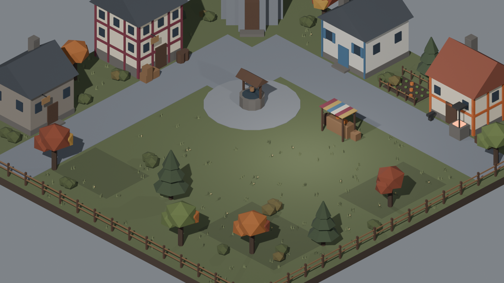

# Pallbrook

A 2.5D investigation game about a doctor called to a small town where people are
falling ill from an anemia no one can explain. By day you examine patients, question
the townsfolk and piece together the previous doctor's torn diary. By night, one of
them hunts. Find the vampire, convince the town at a hearing, and survive long enough
to be believed.



**Status:** in development · playtest builds for Windows and macOS ·
English, Português (Brasil), Español, 日本語 · built in Godot 4.7 with GDScript.

<!-- TODO: add a short gameplay GIF here and a download link (itch.io or GitHub Releases) -->

## How to play

- **Day:** talk to townsfolk, ask about alibis and what they saw last night, and examine
  patients. Every exam is recorded on a hospital-style patient chart in your casebook.
- **Night:** the vampire leaves home to feed. Watch a door and it may give up for the
  night — but being seen out late changes how the town treats you.
- **Clues:** a bite mark marks a victim, not the vampire. Contradictions only count once
  *you* compare two statements and find them.
- **The hearing:** accuse someone in front of the town, present your evidence and let
  them vote. You get two hearings per run. Convict an innocent and you pay for it;
  fail against the real vampire and it comes for you.

## What's interesting under the hood

### A vampire with a body, not a script
`VampireDirector` picks a secret vampire each run and simulates its night. It has its
own blood level that drops every dawn: well fed, it bites carefully and can walk out on
foggy days as an ordinary person; starving, it bites twice as hard and turns reckless.
Every number that shapes a run — hunt hours, bite size, hunger, how often a clue points
to the real culprit — is an exported variable, so balance changes happen in the
inspector, not in code.

### Systems that don't know about each other
Global signals live in one `EventBus` autoload (`phase_changed`, `npc_died`,
`clue_found`, `hour_changed`…). The day/night cycle, NPCs, HUD, audio and casebook
react to events instead of calling each other, which kept a growing project from
turning into a web of references.

### Characters are data
Each of the 7 townsfolk is a `.tres` resource in `data/npcs/` — name, role, home,
an hour-by-hour schedule, dialogue, a clue trait and a portrait. Adding a character means adding a file, not editing
`NPC.gd`.

### Four languages from one table
Every line on screen is a key in `localization/strings.csv` (~650 keys × EN, JA, PT-BR,
ES), served through Godot's translation server and a small `Lang` autoload. The game
starts in the system language and can switch from the title screen. The Japanese build
exists because Japanese-speaking friends asked to playtest it.

### Playtesting built into the game
A `Playtest` autoload quietly logs what happens in each run — the day reached, deaths,
collapses, who was accused, time spent reading — and writes a readable `.txt` plus a
`.json` for comparing testers. At the end of a run it asks four short questions
(who did you suspect, what confused you, what did you enjoy, anything else).
Design changes come from those reports, not guesses.

## Decided by playtesting

<!-- Fill each one with what testers did, what you changed, and the result. -->

- **The health bar gave the vampire away on day one.** The vampire was the only
  person *not* losing blood. It now starts the game freshly fed, so day one looks normal.
- **Daytime felt empty.** Testers waited for night. Added actions that cost in-game
  hours (library research, the merchant, town records), so time itself became the
  resource.
- **A bite mark looks like a confession.** It actually marks a victim. Kept the
  misdirection, but added a hint that a bite trace on clothes can be misleading.

## Project structure

```
autoload/      Global singletons: EventBus, GameState, Lang, Audio, Settings, Playtest
scenes/        Godot scenes (town, buildings, UI)
scripts/
  cycle/       DayNightCycle, VampireDirector
  npc/         NPC behaviour, schedules and visuals
  ui/          Casebook (Notebook), Hearing, Mural, Dialogue, HUD, Tutorial
  world/       Clinic mural, diary pages, merchant, safe zones
data/npcs/     One resource per character
localization/  strings.csv — every on-screen line, four languages
assets/        Models, portraits, audio, fonts, UI theme
```

## Running it

1. Install [Godot 4.7](https://godotengine.org/download).
2. Clone this repository and open `project.godot`.
3. Press **F5**.

## Design process

The design lives outside the code: a FigJam dev diary (in Portuguese, with an English
copy) and a design document covering the endings, the casebook, the vampire's rules
and planned expansions. Casebook layouts are prototyped in Figma before they are
built.

## Credits

3D characters and town kits by [Quaternius](https://quaternius.com) (CC0). Music and
sound effects are listed with their licences in [CREDITS.md](CREDITS.md).

## Author

Saulo de Andrade Costa · [LinkedIn](https://www.linkedin.com/in/saulo-a-costa) ·
[Portfolio](https://portfolio-saulo.vercel.app/)
